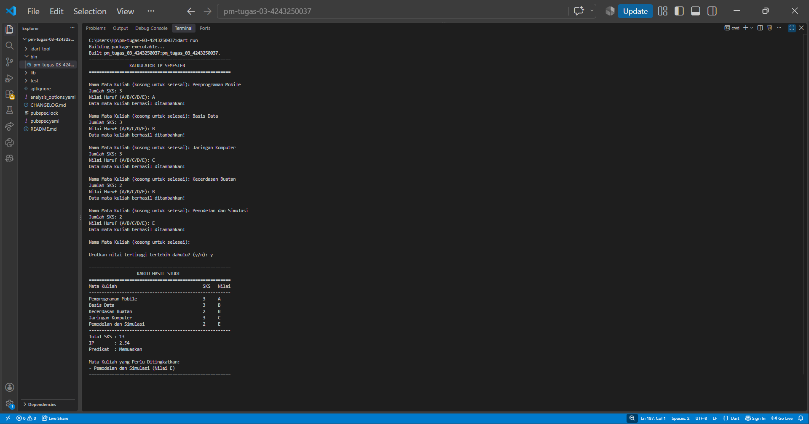
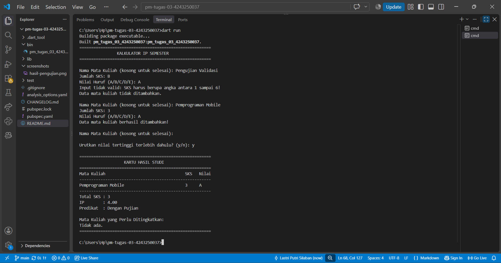

# TUGAS RUTIN 3 – KALKULATOR IP SEMESTER

## 1. Identitas Mahasiswa

- **Nama:** Lastri P. Silaban
- **NIM:** 4243250037
- **Program Studi:** Ilmu Komputer
- **Mata Kuliah:** Pemrograman Mobile

## 2. Deskripsi Program

Kalkulator IP Semester merupakan aplikasi berbasis console yang dibuat menggunakan bahasa pemrograman Dart. Program ini digunakan untuk memasukkan data mata kuliah, jumlah SKS, dan nilai huruf, kemudian menghitung Indeks Prestasi (IP) semester.

Program dapat menerima beberapa data mata kuliah secara berulang. Pengguna dapat mengakhiri proses input dengan mengosongkan nama mata kuliah. Program juga melakukan validasi terhadap jumlah SKS dan nilai huruf agar data yang dimasukkan sesuai ketentuan.

## 3. Fitur Program

1. Input data mata kuliah secara berulang.
2. Konversi nilai huruf A, B, C, D, dan E menjadi bobot angka.
3. Validasi jumlah SKS dan nilai huruf.
4. Perhitungan IP semester.
5. Penentuan predikat berdasarkan IP.
6. Menampilkan mata kuliah dengan nilai di bawah C.
7. Pengurutan mata kuliah berdasarkan nilai tertinggi.

## 4. Teknologi yang Digunakan

- Bahasa pemrograman: Dart
- Editor: Visual Studio Code
- Dart SDK

## 5. Cara Menjalankan Program

Pastikan Dart SDK sudah terpasang. Buka terminal pada folder proyek, kemudian jalankan:

```bash
dart run
```

Untuk memeriksa kode, jalankan:

```bash
dart analyze
```

## 6. Penerapan Higher-Order Function dan Error Handling

Higher-order function diterapkan melalui penggunaan fungsi yang menerima fungsi lain sebagai argumen. Pada program ini, penerapannya dapat ditemukan pada penggunaan `fold()` dalam fungsi `hitungIp()` untuk menghitung total mutu dan total SKS. Fungsi `where()` digunakan untuk menyaring mata kuliah dengan bobot nilai di bawah 2. Sementara itu, `sort()` digunakan untuk mengurutkan mata kuliah berdasarkan nilai tertinggi dengan bantuan fungsi pembanding `bandingNilai()`. Program juga menggunakan fungsi anonim sebagai callback dalam proses pengolahan data.

Error handling diterapkan pada fungsi `validasiData()` menggunakan `throw FormatException` untuk menangani input SKS atau nilai huruf yang tidak valid. Kesalahan tersebut ditangkap menggunakan `try-catch` pada fungsi `main()`. Dengan demikian, data yang tidak valid tidak dimasukkan ke dalam daftar mata kuliah dan program tetap dapat melanjutkan proses input tanpa berhenti.

## 7. Screenshot Pengujian

Screenshot pengujian program dapat dilihat pada folder `screenshots`.




Pengujian dilakukan menggunakan beberapa mata kuliah dengan nilai A, B, C, dan E. Pengujian juga mencakup proses pengurutan nilai dan validasi input.

## 8. Pernyataan Penggunaan AI

Dalam pengerjaan tugas ini, AI digunakan sebagai alat bantu untuk memahami materi, memperoleh arahan penyusunan kode, dan membantu pemeriksaan program. Kode dipelajari dan diuji kembali secara mandiri untuk memastikan program berjalan sesuai dengan ketentuan tugas.

## 9. Contoh Hasil Pengujian

Pengujian dilakukan dengan memasukkan lima mata kuliah dengan total 14 SKS. Hasil perhitungan menunjukkan total mutu sebesar 35 dan IP semester sebesar 2,50 dengan predikat Memuaskan.

Program juga berhasil mengurutkan mata kuliah berdasarkan nilai tertinggi dan menampilkan mata kuliah yang perlu ditingkatkan.